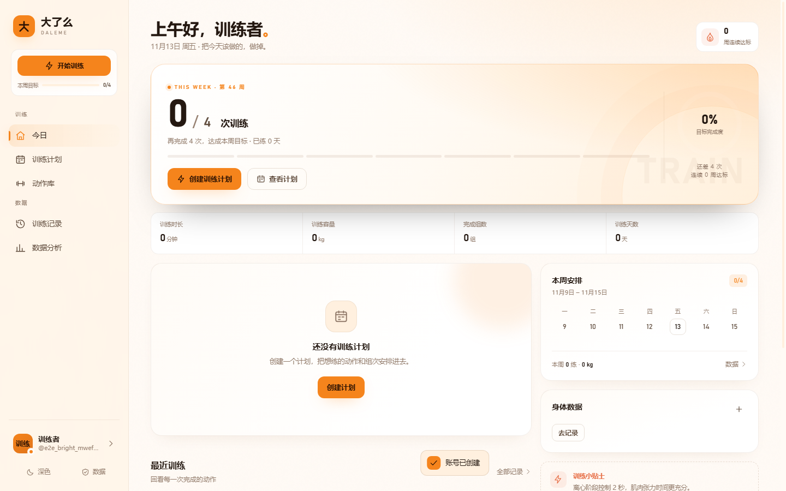

# 大了么

一款训练计划与训练记录 Web 应用。围绕 **计划 → 训练记录 → 数据复盘** 的主线，帮你把每一组重量都记下来。

> **品牌与配色**：应用名为「大了么」（DALEME），图标为「大」字。整体采用**明亮的暖橙主题**：默认浅色（暖奶油底 + 纯白卡片），可一键切换成暖棕「柔暗」深色；两套主题、动作库、图表、分享长图使用同一套橙色色板，不含绿色。

这一版加入了 **账号系统、SQLite 数据库与云端同步**：应用**必须登录后才能使用**，未登录时只显示登录页，看不到任何应用内容；云端是唯一数据源，登录后每次改动自动同步，可在不同浏览器/设备上继续训练。



更多界面：[登录页](docs/preview-bright-login-light.png) · [深色主题](docs/preview-bright-home-dark.png) · [我的](docs/preview-bright-profile.png) · [BMI 刻度](docs/preview-bright-body.png) · [手机端身体数据](docs/preview-bright-body-mobile.png) · [动作库](docs/preview-brand-exercises-dark.png) · [分享长图](docs/preview-brand-share-poster.png) · [大大广场](docs/preview-social-square.png) · [关注流](docs/preview-social-following.png) · [分享详情](docs/preview-social-post-detail.png) · [训练者主页](docs/preview-social-user.png) · [手机端广场](docs/preview-social-square-mobile.png)

> `docs/` 下未列出的 `preview-*.png` 为旧版本截图，仅作历史留档，不反映当前界面。

## 功能

- **今日首页**：本周训练进度、连续达标周数、今日建议训练、最近记录、体重趋势。
- **训练计划**：多计划管理，自定义训练日、动作、组数、次数、休息时间；支持复制、删除、设为当前计划。
- **计划模板库**：内置 6 套常用分化（全身三练、上下肢四分化、推拉腿三分化、胸背腿三分化、部位五分化、居家哑铃两练），选中模板会带着动作、组次与建议重量直接打开计划编辑器，改完保存即可开练。
- **训练进行中**：自动带入上次同动作的重量与次数，逐组勾选完成（也支持回车完成），自动开始组间休息倒计时（可 +15 秒 / 跳过），记录 RPE 与动作备注。
- **自动 PR**：训练结束时自动对比历史，识别重量 / 估算 1RM 的个人新纪录。
- **训练记录**：按月归档，可搜索计划、训练日、动作，支持本月 / 近 30 天筛选、训练详情、复制摘要、一键重做。
- **分享长图**：把某次训练生成 1500px 宽的高清竖版 PNG（日期、四项数据、PR、逐动作组次、训练感受、品牌页脚），可保存到本地、复制图片、调起系统分享，或长按图片发到微信。
- **数据分析**：周容量柱状图、肌群分布、训练节奏、16 周热力图、个人最佳排行。
- **动作库**：接入 [exercises-dataset](https://github.com/hasaneyldrm/exercises-dataset) 的 **1,324 个动作**；按 **10 个部位 / 26 种器械** 筛选与分组、搜索（中英文名 / 器械 / 肌群）、每个动作都有 **演示 GIF**、详情页含中英文分步动作要领；仍支持自定义动作。
- **大大广场（社交）**：把某次训练**分享到广场**，所有登录用户都能看到；**互相关注**后，关注的人有新分享会出现在「关注」流里；支持**点赞**、评论式配文、**找训练者**（搜索 / 推荐）、训练者主页（分享数 / 关注 / 粉丝）；只分享单次训练的固化快照，其余训练数据仍为私有。
- **身体数据与 BMI**：身高、体重、性别设置，体重 / 体脂记录与趋势图；BMI 卡片按**中国成人标准**（18.5 / 24 / 28）显示四段刻度、分界值、当前位置指针、所处区间与健康体重范围。
- **「我的」二级页面**：首页只保留身份概览 + BMI + 四个入口，登录同步、训练偏好、身体数据、数据管理分别放到独立页面。
- **账号与云同步**：必须登录才能使用；注册 / 登录、HttpOnly Cookie 会话、改动自动同步、手动同步；云端为唯一数据源。
- **账号安全**：修改密码（自动吊销其他设备）、退出所有设备、注销账号。
- **数据安全**：服务端 SQLite 持久化 + 本机 localStorage 作为离线工作副本；支持 JSON 导出 / 导入、清空数据。
- **响应式**：移动端底部导航 + 桌面端侧边栏，**默认明亮的浅色主题**，可切换柔暗深色。

## 运行

需要 **Node.js 22.5+**（使用内置 `node:sqlite`，无第三方依赖）。

```bash
npm start
```

然后打开 <http://127.0.0.1:4173>。

Windows 下也可以直接双击 `start.bat`（仅本机访问），或双击 `start-lan.bat` 以局域网模式启动（同一 WiFi 下的手机 / 平板可通过 `http://本机IP:4173` 访问）。

> 不能直接双击 `index.html`：应用使用 ES Modules，需要通过 HTTP 访问。

打开即是 **登录页**：已有账号直接登录；新账号注册后从空白状态开始（不再内置任何示例计划或演示数据）。HTML 首帧就处于登录模式，不会先闪出侧边栏或训练数据；所有数据接口都要求有效会话，未登录请求会返回 401。

## 账号与同步

1. **每次新打开应用（新标签页 / 新窗口 / 重启浏览器）都要求重新登录**；默认不记住登录状态，登录时下发的 Cookie 是不带 `Max-Age` 的会话级 Cookie。
2. 同一标签页内刷新不会掉线，无需反复输入密码。
3. 登录 / 注册表单有「记住登录」勾选项（默认不勾选）：勾选后会话持久化 30 天，之后打开可自动进入；不勾选则始终保持第 1 条的严格门禁。
4. 注册新账号会从空白开始，可以立刻创建计划；也可以在「我的 → 数据管理」导入旧备份。
5. 登录后每次保存训练、修改计划、记录体重都会在约 1 秒后自动同步到服务器。
6. 「我的 → 账号与同步」页面显示「已同步 / 待同步 / 同步失败」，也可以点「立即同步」。
7. 换设备登录同一账号会自动拉取云端数据（云端为准）。
8. 同一个页面里可以修改密码（其他设备自动退出）、一键退出所有设备、注销账号（云端数据永久删除）；主动退出登录会同时清除「记住登录」偏好。
9. 会话过期时应用会自动回到登录页，不会静默丢失账号归属。

## 计划模板

「训练计划 → 模板库」（或计划页里的「从模板创建」卡片）提供 6 套预设分化，解决「新建计划是一片空白、不知道练什么」的问题：

| 模板 | 频率 | 适合 |
|---|---|---|
| 全身三练 · 新手起步 | 3 天 / 周 | 刚进健身房，先把深蹲、卧推、划船的动作模式练熟 |
| 上下肢四分化 | 4 天 / 周 | 上肢 / 下肢各两次，A 日偏力量、B 日偏容量 |
| 推拉腿三分化 | 3 天 / 周 | 推（胸肩三头）/ 拉（背二头）/ 腿，训练频率高 |
| 胸背腿三分化 | 3 天 / 周 | 一次只练一个大肌群，器械齐全、想堆容量 |
| 部位五分化 | 5 天 / 周 | 胸 / 背 / 腿 / 肩 / 臂各一天，单部位容量拉满 |
| 居家哑铃两练 | 2 天 / 周 | 一对哑铃 + 一张卧推凳，出差或在家训练 |

- 选中模板后**不会立刻创建计划**，而是打开预填好训练日、动作、组次、建议重量与休息时间的计划编辑器；名称、动作、重量都可以改，保存后才真正写入。
- 模板里的动作全部引用动作库（1,324 条中的条目）与历史兜底动作，因此计划详情、训练中的 GIF 缩略图、PR 与力量趋势都能正常工作。
- 模板数据在 `assets/js/plan-templates.js`：新增一套模板 = 往 `PLAN_TEMPLATES` 里加一个对象（`days[].exercises` 用 `[动作 id, 组数, 次数, 建议重量, 休息秒]` 声明）；`test/plan-templates.test.mjs` 会校验动作 id 是否存在、组次是否在编辑器限制内、同一天是否重复安排同一动作。

## 大大广场（社交）

「大大广场」是应用里的社区模块：你可以把某一次训练分享出去，让其他训练者看到，也可以关注别人、在「关注」流里只看关注的人的动态。

**分享方式**（任选其一）：

- 广场页右上角「分享训练」→ 从最近 20 次训练里挑一次 → 写一句感受 → 发布。
- 「训练记录 → 某次训练详情」里的「分享到广场」按钮（弹层会自动选中这一次训练）。

**广场 / 关注**

- 广场按时间倒序展示所有登录用户的分享；「关注」Tab 只展示**自己 + 关注的人**的分享，没有关注对象时会引导去发现训练者。
- 动态卡片展示训练日名称、容量 / 组数 / 时长 / 动作数、本次 PR、前三个动作与最佳组次；点卡片进入**分享详情**，可查看完整的逐动作组次与训练感受。
- 每条动态都可以**点赞**（再点一次取消）；自己的动态可以随时删除（只删分享，不删训练记录）。
- 「找训练者」弹层支持按昵称 / 用户名搜索；侧栏「发现训练者」会推荐还没关注的活跃训练者。
- 训练者主页（点头像或昵称进入）展示公开资料、分享 / 关注 / 粉丝数，以及 TA 的全部分享；桌面端导航有「大大广场」与「关注」两个入口，手机端底部导航有「广场」。

**隐私与数据设计**

- 发布时由**服务端**从你的云端训练数据里提取一份**固化的训练快照**（训练日、动作名、组数、重量、次数、时长、感受），客户端无法伪造他人的成绩；之后修改或删除本地记录，也不会改动已发布的动态。
- 快照只包含这一次训练的内容，计划、身体数据、历史记录等其余数据仍然完全私有；不想展示了随时删除即可。
- 每次训练只能分享一次，避免广场被重复动态刷屏；昵称来自「我的 → 编辑资料」的称呼，自动同步到公开资料。

## 我的与 BMI

「我的」首页只保留身份概览、BMI 卡片和四个入口，其余内容都收进二级页面：

| 入口 | 路由 | 内容 |
|---|---|---|
| 身体数据 | `#/profile/body` | 性别 / 身高 / 当前体重 / 体脂、BMI 刻度卡、体重趋势与历史记录 |
| 训练偏好 | `#/profile/preferences` | 每周目标、默认组间休息、外观主题、重量单位 |
| 账号与同步 | `#/profile/account` | 登录状态、立即同步、退出登录、修改密码、退出所有设备、注销账号 |
| 数据管理 | `#/profile/data` | 导出备份、导入备份、清空全部数据 |

身高和性别保存在 `settings`（随云端同步）；**体重取自最新一次体测记录**，与体重趋势共用一份数据，不会出现两个互相矛盾的体重。BMI 采用中国成人分界值：`< 18.5` 偏瘦、`18.5–23.9` 正常、`24–27.9` 超重、`≥ 28` 肥胖，刻度轴范围 15–35，指针显示当前所处位置。BMI 仅供参考，不替代医学诊断。

## 分享训练记录

在「训练记录 → 某次训练详情」里，点顶部的分享图标、底部「分享长图」按钮，或右上角「更多 → 生成分享长图」；训练结束弹层里也有「保存并生成分享长图」（保存后自动打开分享弹层）。

长图由浏览器原生 Canvas 绘制，**不依赖任何第三方库或外部服务**，输出 1500px 宽的 PNG（超长记录自动降为 750px 宽以保护内存）。内容包含：品牌与日期、训练日名称、训练时长 / 容量 / 组数 / 次数、本次 PR、逐动作组次（热身组高亮）、动作备注、训练感受、页脚。

弹层里提供四种操作：

| 操作 | 行为 |
| --- | --- |
| 分享到微信 | 支持 Web Share API 的手机浏览器会调起系统分享面板，选择微信即可；不支持时（含微信内置浏览器）提示长按图片 →「保存图片 / 发送给朋友」 |
| 保存到本地 | 下载 `大了么-训练记录-YYYY-MM-DD.png`；微信 / iPhone 内改为提示长按保存到相册 |
| 复制图片 | 通过 `navigator.clipboard.write` 写入 PNG，可直接粘贴到微信聊天（需 HTTPS 或 localhost 安全上下文） |
| 复制文案 | 复制纯文字版训练摘要，方便粘贴到朋友圈 / 群聊 |

> 说明：网页无法直接调用微信的「分享给好友」接口——那需要微信公众号 JS-SDK、appid 签名与已备案域名。因此本项目走系统分享面板 + 长按图片这条通用路径，无需任何微信配置。局域网 HTTP 环境下 `navigator.share` / 剪贴板可能不可用，此时「保存到本地」和「复制文案」仍可用。

## 动作库数据集

动作库来自 [hasaneyldrm/exercises-dataset](https://github.com/hasaneyldrm/exercises-dataset)：**1,324 个动作**，每个动作都带一张 180×180 动画 GIF 和静态缩略图，以及 10 个部位、器械、目标肌群、协同肌群和 10 种语言的分步说明。

**展示方式**

- 部位（上臂 / 大腿 / 背部 / 腰腹 / 胸部 / 肩部 / 小腿 / 前臂 / 有氧 / 颈部）与器械各有独立筛选行，可叠加使用；还可以切换「不分组 / 按部位 / 按器械」把结果分段展示。
- 卡片直接播放对应 GIF（懒加载），首屏 48 个，点「加载更多」继续；搜索支持中文名、英文原名、器械、目标肌群与协同肌群。
- 详情页放大展示 GIF + 中文 / English 动作要领（独立 JSON 按需加载，不进首屏）、部位 / 器械 / 目标肌群 / 协同肌群 / 建议次数，保留个人最佳、力量趋势与历史记录。
- 计划编辑器和训练中的动作选择器会显示缩略图，并只渲染前 60 条结果，避免一次铺开 1,324 项。
- 名称采用「短语词典 + 完整度校验」翻译：约 78% 的动作有中文名（同时保留英文原名），无法可靠翻译的动作直接显示数据集英文原名，不出现半中半英的怪译名。
- 旧版 48 个内置动作已从动作库移除，但仍作为**历史数据兜底映射**保留在 `data.js`，旧计划 / 旧训练记录不会失效。

**为什么 GIF 能离线显示**：全部媒体已镜像到 `assets/exercises/`（约 139 MB），走同源静态服务，因此 CSP 保持严格的 `img-src 'self' data:` 不变，也不需要手机端访问外网。静态服务为 `.gif` 补了 `image/gif` MIME，并对按内容命名的媒体下发 `immutable` 长缓存；二进制媒体不参与构建指纹、不做 gzip 和内容哈希。

**重新生成**（上游更新时）：

```bash
git clone --depth 1 https://github.com/hasaneyldrm/exercises-dataset.git
node scripts/import-exercises.mjs ./exercises-dataset
# 或 npm run import:exercises -- ./exercises-dataset
```

生成物：

| 文件 | 内容 |
| --- | --- |
| `assets/js/exercise-catalog.js` | 精简动作目录（约 437 KB，ES 模块，同步可用） |
| `assets/exercises/details.json` | 中英文分步要领（约 1.1 MB，详情页按需请求） |
| `assets/exercises/videos/*.gif` | 1,324 个动画 GIF |
| `assets/exercises/images/*.jpg` | 1,324 个静态缩略图 |
| `assets/exercises/NOTICE.md` / `LICENSE.txt` | 上游媒体署名与许可 |

中文映射词典在 `scripts/exercise-i18n.mjs`，生成器在 `scripts/import-exercises.mjs`；两者都不需要第三方依赖。

> ⚠️ **版权提示**：动作**数据**（名称、分类、说明文本）为 MIT 许可，但 **GIF / 缩略图版权归 [Gym visual](https://gymvisual.com/) 所有**，上游以 180×180 分辨率经授权分发。本项目已在动作库与详情页保留 `© Gym visual` 署名，并随附 `NOTICE.md` / `LICENSE.txt`。**用于公开部署或商业用途前，请自行阅读 [Gym visual 使用条款](https://gymvisual.com/content/3-terms-and-conditions-of-use) 并取得相应授权**；克隆上游仓库本身不等于获得媒体授权。

## 许可证

- **本项目（代码 / UI / 原创内容）**：[CC BY-NC-SA 4.0](LICENSE) —— **禁止商用**，可分享与改编（须署名、相同方式共享）。商业使用请联系作者取得单独授权。
- **动作数据集（文本 / 数据）**：MIT 许可，见 [`assets/exercises/LICENSE.txt`](assets/exercises/LICENSE.txt)。
- **动作媒体（GIF / 缩略图）**：© Gym visual，需另行取得授权，见 [`assets/exercises/NOTICE.md`](assets/exercises/NOTICE.md) 与 [`THIRD-PARTY.md`](THIRD-PARTY.md)。

详细的许可层级与合规建议见 [THIRD-PARTY.md](THIRD-PARTY.md)。

## 生产部署

### 前端资源缓存与更新

服务端会自动为前端资源生成内容指纹（`BUILD_ID`）：`index.html` 里的 `<script>` / `<link>`，以及 ES Module 内部的相对 `import`，都会被重写成 `xxx.js?v=<指纹>`；同时把指纹写入 `<html data-build="...">`。

| 资源 | 缓存策略 |
| --- | --- |
| `index.html` | `no-store`，每次都取最新版本 |
| 带当前指纹的 URL | `max-age=31536000, immutable`，可长期缓存 |
| `assets/exercises/{images,videos}/*` | `max-age=31536000, immutable`（文件名含上游 media_id，内容不变） |
| 无指纹 / 指纹已过期（旧客户端） | `no-cache` + ETag 协商，保证拿到新内容 |

任一 `assets/` 下的 JS / CSS 文件变化都会让指纹变化（动作库二进制媒体不参与计算），旧缓存 URL 不再被引用，所以**更新代码后（前端改完立即生效，服务端改完需重启）客户端只需刷新一次页面，不必手动清缓存**。

如果手机仍显示旧界面（多见于微信内置浏览器、或「添加到主屏幕」的快捷方式）：

1. 查看浏览器页面源码里 `<html data-build="...">` 的 12 位指纹，与服务端 `index.html` 是否一致；
2. 用无痕窗口打开一次，或在浏览器设置里清除该站点缓存；
3. 确认访问地址仍是当前机器的局域网 IP（DHCP 分配的地址可能变化）。

### 环境变量

| 变量 | 默认值 | 说明 |
| --- | --- | --- |
| `PORT` | `4173` | 监听端口 |
| `HOST` | `127.0.0.1` | 监听地址；公网部署设为 `0.0.0.0` |
| `DATA_DIR` | `./data` | 数据目录（含数据库与备份） |
| `DB_PATH` | `<DATA_DIR>/liantrace.db` | SQLite 数据库文件 |
| `LOG_DIR` | `./logs` | 结构化日志目录（app.log / access.log） |
| `LOG_LEVEL` | `info` | `debug` / `info` / `warn` / `error` |
| `COOKIE_SECURE` | `0` | HTTPS 部署时设 `1`：Cookie 加 Secure 并下发 HSTS |
| `TRUST_PROXY` | `0` | 反向代理后设 `1`：从 `X-Forwarded-For` 取真实 IP（日志与限流） |
| `CSP` | `1` | 内容安全策略开关（排障可临时关闭） |
| `SESSION_DAYS` | `30` | 「记住登录」时的会话有效期（天）；未勾选记住登录时 Cookie 随浏览器关闭失效 |
| `MAX_SESSIONS_PER_USER` | `20` | 单用户会话上限，超出自动清理最早会话 |
| `REGISTER_LIMIT` | `8` | 每小时每 IP 注册次数 |
| `LOGIN_LIMIT` | `20` | 15 分钟每 IP 登录次数 |
| `LOGIN_USER_LIMIT` | `10` | 15 分钟内针对单个用户名的失败登录上限 |
| `BACKUP_KEEP` | `7` | 保留的数据库备份份数 |
| `BACKUP_ON_START` | `1` | 启动时是否执行一次数据库备份 |
| `MAX_BODY_BYTES` | `6291456` | 请求体大小上限 |

### Docker（推荐）

```bash
docker compose up -d --build
```

数据与日志通过卷挂载在 `./data` 与 `./logs`，容器以非 root 用户运行并内置健康检查。

### 裸机 / Node 直接部署

```bash
HOST=0.0.0.0 PORT=4173 COOKIE_SECURE=1 TRUST_PROXY=1 npm start
```

- 公网部署请放在 HTTPS 反向代理（Nginx / Caddy）后，并设置 `COOKIE_SECURE=1`；代理同时设 `TRUST_PROXY=1`，否则限流与日志记录的都是代理 IP。
- **优雅停机**：`SIGTERM` / `SIGINT` 会停止接收新连接、等待在途请求（最多 10 秒）后关闭数据库。systemd、PM2、Docker 的默认停止信号都会被正确处理。
- PM2 集群模式**不适用**（SQLite 单写者 + 内存限流），请使用 `fork` 模式单实例；如需多实例需要改造为集中式限流与数据库层。

### 备份

- 服务启动时与每 24 小时自动通过 SQLite `VACUUM INTO` 生成一致性快照到 `data/backups/`，默认保留最近 7 份。
- 手动备份：直接复制 `data/liantrace.db`（以及 `-wal` / `-shm`），或降低 `BACKUP_ON_START=0` 后重启触发一次。

### 可观测性

- `logs/app.log`：JSON Lines 结构化日志（启动、备份、登录成功/失败、账号操作、未捕获异常等）。
- `logs/access.log`：HTTP 访问日志（方法、路径、状态码、耗时、客户端 IP）。
- `GET /api/health`：健康检查，含数据库探测与版本号，容器 HEALTHCHECK 使用。

## 数据说明

- 浏览器本地存储键：`liantrace.state.v1`（当前登录账号的离线工作副本）
- 云同步元数据：`liantrace.sync.v1`
- 采用云端前自动备份：`liantrace.backup.before-adopt`
- 服务端数据库：`data/liantrace.db`（SQLite，WAL 模式）
- 重量单位：kg
- 估算 1RM 使用 Epley 公式：`重量 × (1 + 次数 / 30)`
- 训练容量 = Σ(已完成组重量 × 次数)，热身组不计入
- 未登录时只能看到登录页，不会上传任何数据；登录后整份训练状态会同步到对应账号。

## API

| 方法 | 路径 | 说明 |
| --- | --- | --- |
| GET | `/api/health` | 服务健康检查（含数据库探测） |
| POST | `/api/auth/register` | 注册并建立会话 |
| POST | `/api/auth/login` | 登录并建立会话 |
| POST | `/api/auth/logout` | 退出当前设备 |
| POST | `/api/auth/logout-all` | 退出所有已登录设备 |
| PUT | `/api/auth/password` | 修改密码并吊销其他设备会话 |
| DELETE | `/api/account` | 注销账号（需密码确认） |
| GET | `/api/auth/me` | 当前登录用户 |
| GET | `/api/data` | 获取云端训练数据 |
| PUT | `/api/data` | 覆盖保存云端训练数据 |
| GET | `/api/social/feed` | 大大广场 / 关注信息流（`scope=square|following`，`before` 游标分页） |
| POST | `/api/social/posts` | 分享一次训练到大大广场（服务端固化快照） |
| GET | `/api/social/posts/:id` | 分享详情 |
| DELETE | `/api/social/posts/:id` | 删除自己的分享 |
| POST / DELETE | `/api/social/posts/:id/like` | 点赞 / 取消点赞 |
| GET | `/api/social/users?q=` | 搜索训练者（无关键词时推荐） |
| GET | `/api/social/users/:id` | 训练者主页（资料 + 动态） |
| POST / DELETE | `/api/social/users/:id/follow` | 关注 / 取消关注 |
| GET | `/api/social/users/:id/followers` / `/following` | 粉丝 / 关注列表 |
| GET / PUT | `/api/social/profile` | 公开资料（昵称 / 简介） |
| GET | `/api/social/avatar/:userId` | 其他训练者的头像（需登录） |

安全策略：CSP / HSTS / X-Frame-Options 等安全头、同源校验（防 CSRF）、多级限流、scrypt 加盐密码哈希、HttpOnly + SameSite Cookie、服务端仅存会话哈希。

## 测试

```bash
npm test
```

集成测试会真实启动服务器（随机端口、临时数据目录），20 项测试覆盖注册登录、数据同步、改密码、退出所有设备、注销账号、限流、路径穿越、CSP/ETag/gzip、头像，以及大大广场（发布快照 / 重复分享拦截 / 广场与关注流 / 点赞 / 关注 / 主页 / 游标分页 / 级联删除）、动作库目录完整性（1,324 条记录 / GIF / 中文要领）、GIF 的 MIME 与长缓存等行为。

另有 `test/plan-templates.test.mjs`（6 项）校验计划模板：id 唯一、训练日与动作数量在编辑器限制内、引用的动作 id 都能在动作库或历史兜底动作中解析、同一天不重复安排同一动作，以及 `buildPlanDraft()` 生成的草稿是独立副本。

## 项目结构

```text
index.html
assets/
  css/styles.css
  exercises/          # 动作库媒体（1,324 GIF + 缩略图）与署名、中文要领
    videos/           # *.gif
    images/           # *.jpg
    details.json      # 中英文分步动作要领
    NOTICE.md         # Gym visual 媒体署名
  js/
    app.js            # 应用外壳、路由、启动与账号同步引导
    theme.js          # 首屏主题预加载（避免闪白）+ 亮色默认迁移
    bmi.js            # BMI 纯函数：分界值、刻度、健康体重范围
    body-view.js      # 身体信息读取与 BMI 刻度卡片
    data.js           # 部位 / 器械分类、历史动作兜底、空白默认状态
    plan-templates.js # 6 套训练计划模板 + 模板草稿生成
    exercise-catalog.js  # 生成的 1,324 条动作目录（勿手动编辑）
    exercise-utils.js # 双语名称、GIF 渲染、要领按需加载
    store.js          # 状态、选择器、导入导出
    api.js            # 后端 API 客户端
    sync.js           # 登录状态、自动同步（云端为准）
    account.js        # 登录页、账号卡片、账号安全
    poster.js         # 训练长图 Canvas 渲染（排版测量 + 绘制）
    share.js          # 分享弹层：保存 / 微信 / 复制图片 / 复制文案
    social.js         # 社交共享件：广场卡片、关注按钮、发布弹层、找人弹层
    ui.js             # 图标、弹层、Toast、通用组件
    charts.js         # 纯 SVG 图表
    utils.js          # 日期、数字、格式化工具
    views/            # 各页面视图
      profile.js      # 「我的」首页（身份 + BMI + 四个入口）
      profile-sections.js  # 身体数据 / 训练偏好 / 账号与同步 / 数据管理
      square.js       # 大大广场 / 关注信息流
      post-detail.js  # 分享详情（完整逐动作组次）
      user-profile.js # 训练者主页（资料 / 关注 / 粉丝 / 分享）
server.mjs            # 服务入口：HTTP、超时、优雅停机、定时任务
server/
  config.mjs          # 环境变量集中读取与校验
  logger.mjs          # 结构化日志
  db.mjs              # SQLite：连接、Schema、语句、备份
  auth.mjs            # 密码哈希与会话管理
  security.mjs        # 限流、来源校验、安全头
  handlers.mjs        # API 路由
  social.mjs          # 社交模块：广场 / 关注 / 点赞 / 训练者主页 / 快照生成
  json.mjs            # JSON 请求 / 响应辅助（handlers 与 social 共用）
  static.mjs          # 静态资源：内容指纹版本化、ETag/304、gzip、缓存策略
scripts/
  import-exercises.mjs  # 从上游数据集重新生成动作库（媒体 + 目录）
  exercise-i18n.mjs     # 部位 / 器械 / 动作名中文映射词典
test/api.test.mjs     # API 与动作库集成测试
test/bmi.test.mjs     # BMI 分界值 / 刻度 / 健康体重范围单元测试
test/plan-templates.test.mjs  # 计划模板结构与动作 id 校验
Dockerfile            # 生产镜像（非 root、HEALTHCHECK）
docker-compose.yml    # 一键部署
data/                 # SQLite 数据库与备份（运行时生成）
logs/                 # 运行日志（运行时生成）
```

## 技术栈

原生 HTML / CSS / JavaScript（ES Modules）+ Node.js 内置 `http` / `node:sqlite` / `crypto`。无框架、无构建步骤、无第三方运行时依赖。图表使用手写 SVG。

---

每一次，都算数。
